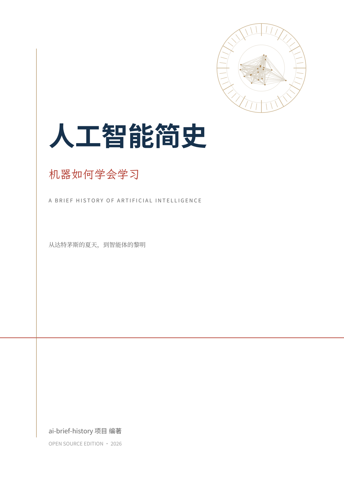

# 人工智能简史：机器如何学会学习

> 从图灵之问到 ChatGPT，从符号主义到深度学习，从专家系统到智能体——一部关于机器如何学会学习的历史。



## 关于本书

这是一本面向普通读者的中文 AI 科普简史。它不堆砌术语，也不追逐每一个模型版本，而是试图回答三个问题：

- 人工智能从哪里来？
- 它为什么一次又一次地热潮与寒冬？
- 它正在把我们带向哪里？

全书分为四部，对应四次关于“智能从哪里来”的押注：**符号、学习、规模、具身**。每一章都有一个核心论点，每一部都有一条从“上一部的极限”到“下一部的突破”的线索。中国 AI 的故事没有单独成章，而是以“中国坐标”的形式嵌在各个阶段里。

- **作者**：ai-brief-history 项目 编著
- **版次**：2026 年 11 月 · 第一版
- **篇幅**：约 5.1 万字，117 页，9 幅矢量插图
- **许可**：文本 CC BY-NC-SA 4.0；代码 MIT
- **PDF**：[下载](output/人工智能简史.pdf)

## 目录

**序章 机器能思考吗？**

**第一部 符号的雄心（远古—1974）**

- **第一章** 从神话到机器
- **第二章** 计算的边界
- **第三章** 达特茅斯的夏天
- **第四章** 感知机的狂欢与第一次寒冬

**第二部 知识的工程（1974—1993）**

- **第五章** 专家系统：把知识装进机器
- **第六章** 寒冬再临与连接主义的暗流

**第三部 学习的胜利（1993—2017）**

- **第七章** 数据上场
- **第八章** ImageNet 时刻
- **第九章** 从棋盘到现实

**第四部 规模的信仰（2017—2026）**

- **第十章** 注意力革命
- **第十一章** ChatGPT 时刻
- **第十二章** 从回答到行动
- **第十三章** 未完成的智能

**尾声 下一个达特茅斯**

**附录**：人工智能大事年表（世界篇 / 中国篇）、人物小传、术语表、延伸阅读、写作说明。

## 这本书想做什么

- **一条主线**：从“把知识写进机器”到“让机器自己学习”，再到“让规模自己说话”，最后回到“我们到底想要什么样的智能”。
- **一个平衡**：既写论文、算法、产品，也写资金、政策、媒体和人的选择；既不神化 AI，也不唱衰 AI。
- **一个视角**：中国 AI 不是“另一桌”，而是全球 AI 史的一部分；有追赶、有并跑，也有被“卡脖子”后的效率创新。

## 项目结构

```
ai-brief-history/
├─ content/                 # 正文 Markdown 源文件（序章、13 章、尾声、附录）
├─ build/
│  └─ make_book.py          # 排版脚本：Markdown → PDF（ReportLab）
├─ fonts/                   # 构建所需 OFL 字体（约 73 MB，不随仓库提交）
├─ assets/
│  └─ cover.png             # 封面渲染图
├─ output/
│  └─ 人工智能简史.pdf       # 最终 PDF
├─ docs/
│  ├─ 01-目录设计的三次推敲.md
│  ├─ 02-写作规范与事实核查.md
│  ├─ 03-结构终审.md
│  └─ 04-审校与修订记录.md
└─ README.md
```

## 如何构建

本书的 PDF 由 Python + ReportLab 生成，版面、插图、目录、页眉页脚都在 `build/make_book.py` 里。

```bash
pip install reportlab pypdfium2
python build/make_book.py
```

说明：

- 构建使用 `fonts/` 下的开源字体，不再依赖 Windows 系统字体，需要以下 5 个文件：
  - `NotoSerifSC-Regular.ttf`、`NotoSerifSC-Bold.ttf`
  - `NotoSansSC-Regular.ttf`、`NotoSansSC-Bold.ttf`
  - `LXGWWenKai-Regular.ttf`
- 字体文件不随仓库提交（约 73 MB），可从 [Noto CJK](https://github.com/notofonts/noto-cjk)、[霞鹜文楷](https://github.com/lxgw/LxgwWenKai) 获取；缺失时构建会直接报错并列出文件名。
- 版面采用纯白背景和浅色封面、封底、部扉页，减少大面积油墨，适合普通纸张印刷。
- 脚本会自动生成封面、四部扉页、章扉页、目录、页眉页脚、矢量插图和 PDF 书签。
- 输出的 PDF 位于 `output/人工智能简史.pdf`。

## 写作过程

目录不是一次定稿的。`docs/01-目录设计的三次推敲.md` 记录了从“编年史结构”到“五次浪潮结构”，再到“四次押注结构”的推演；`docs/03-结构终审.md` 记录了成书后对章节配比、空白页、图目录、中国内容分布的复核；`docs/04-审校与修订记录.md` 记录了子代理交叉审校后的事实、文字与版式修订。最终目录以 PDF 为准。

## 许可与声明

- **文本**：采用 [CC BY-NC-SA 4.0](https://creativecommons.org/licenses/by-nc-sa/4.0/) 许可协议。你可以自由复制、分发、改编，但需注明出处、不得用于商业目的，并以相同许可分享。
- **代码**：采用 MIT 许可协议，详见 `LICENSE-CODE`。
- **字体**：PDF 中嵌入的思源宋体（Noto Serif SC）、思源黑体（Noto Sans SC）、霞鹜文楷（LXGW WenKai）均采用 SIL OFL 1.1 授权；字体文件不随仓库提交，PDF 中为嵌入子集。
- **声明**：本书由 AI 辅助完成资料整理、结构讨论、初稿生成和文字润色，经人工审校、编辑和排版。资料截至 2026 年 11 月；2024 年之后的事件变化很快，书中的描述是“截至写作时”的快照，不构成投资、法律或政策建议。
- **反馈**：欢迎通过 GitHub issue 指出事实错误、引文不准或表述不当。

## 致谢

感谢所有在公开论文、开源项目、技术博客、新闻报道中分享知识的人；感谢图灵、麦卡锡、明斯基、罗森布拉特、辛顿、李飞飞、梁文锋等一代代研究者，他们的工作让这本书有故事可讲。感谢每一位读到这里的读者。

---

*本书为开源科普项目，非卖品。*
